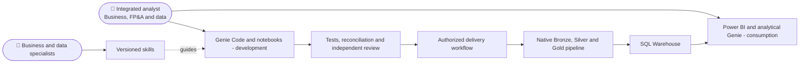

# Databricks Pipeline Template

**Financial pipeline engineering with versioned Genie Code maintenance skills.**
This synthetic-data template combines Bronze/Silver/Gold processing with reusable
guidance for the next professional to evolve business rules and maintain code.
It uses native Python/PySpark patterns, without dbt.

## Interface architecture and the integrated analyst

The proposed operating model combines business, FP&A and data skills in one
analyst, supported by Genie and by specialists who curate financial and data
engineering skills. Competency-based access and independent review of material
changes preserve accountability. Skills guide AI; platform and CI policies must
enforce boundaries.



**Legend:** rounded capsules with 👤/👥 identify people or professional profiles;
rectangles identify tools, artifacts and process steps.

See the [interface, roles and guardrails architecture](docs/ARCHITECTURE_AND_ROLES.md)
for user/developer entry points, two specialist tracks, learning paths and the
distinction between guidance and executable controls. This diagram is a reference
design: remote interfaces, access policies and deployment gates are not deployed
or validated by the local demo.

## AI-assisted engineering and professional handover

Three repository-owned skills support **Genie Code**, the Databricks coding
assistant. They capture the financial invariants, implementation entry points,
regression checks and evidence expected from a change:

| Skill | Purpose |
| --- | --- |
| [finance-business-rules](skills/finance-business-rules/SKILL.md) | Evolve financial rules with explicit contracts and reconciliation |
| [finance-pipeline-maintenance](skills/finance-pipeline-maintenance/SKILL.md) | Diagnose bugs and refactor without breaking versions, replay or totals |
| [finance-release-review](skills/finance-release-review/SKILL.md) | Review changes, test evidence and operational limits before delivery |

**The differentiator is maintainable engineering knowledge alongside code:** a
new professional can inspect the rules, ask Genie Code for a scoped change, and
review its tests and financial impact. Skills guide the assistant; executable
controls remain in the pipeline and its tests. Human review and the authorized
deployment workflow remain necessary.

See the [Genie Code onboarding and maintenance guide](docs/GENIE_CODE_HANDOVER.md)
for registration, example requests and validation steps. These are source skills,
not a deployed Genie integration: **workspace use has not been verified**. No
global installation or workspace registration is performed by this repository.
Genie Spaces for analytical questions are a separate capability.

## Verified local acceptance path

The dependency-free reference backend is SQLite, used to exercise ingestion
contracts and retries without cloud credentials. It is not a Delta emulator.

```bash
python databricks-pipeline-template/notebooks/cost_pipeline_bronze_silver_gold.py --csv databricks-pipeline-template/example.csv --database local-costs.db --batch-id example-1
# Repeat the same command: replay=true; Silver totals remain unchanged.
python -m pytest tests/test_pipeline_contract.py
```

Input fields are strings: source_system, transaction_id, updated_at (with timezone),
month (YYYY-MM-01), cost_center, category, vendor, currency and amount. Only BRL
is supported: no implicit currency conversion. Amounts have at most 16 integer
digits and two decimal places; local current facts use integer cents and the Spark
adapter uses Decimal(18,2). Negative credit entries are retained.

The transaction key is source_system × transaction_id. Distinct transactions with
the same month/category/vendor remain distinct. Highest UTC updated_at wins;
identical versions are duplicates; older versions are retained as superseded.
Conflicting payloads at the same version quarantine that transaction in the input.
A collision against persisted Silver fails the local transaction.

Every input row has a disposition and original record. Counts and known monetary
amounts reconcile across accepted, rejected, duplicate and superseded records.
Malformed monetary values and unsupported currencies remain explicit and are
counted as unknown BRL amounts, excluded from all BRL sums. No currency conversion
or complete monetary reconciliation is claimed for those rows. Stored lineage
includes batch ID and source row. Reusing a batch ID with changed input fails.
SQLite raw/audit/current-fact writes are atomic. Replaying or receiving an older
version does not duplicate or roll back current facts. Deletions are not modeled.

## Spark/Delta adapter boundary

The script also provides explicit JDBC ingestion, UTC and typed transformations,
rejected/discarded snapshots, Silver MERGE and reconciled monthly Gold totals.
Spark workers use the same pure row validator as local tests. The Spark job must
have access to the adjacent pipeline_contract.py file.

- JDBC url and driver must be configured; inject secrets privately.
- Bronze creates load_date, source table, ingestion time and batch ID. For retries,
  use the same Delta txnAppId/txnVersion for the same immutable source batch.
  A different source/table needs its own stable app ID; versions must increase for
  new batches. Never reuse a transaction version for changed input. Source
  extraction must use a consistent snapshot; this adapter does not create one.
- Silver uses the business transaction key and newest version. Quarantine and
  Gold are full snapshots. Delta writes across tables are not one atomic commit;
  a failed run must be retried before publishing its outputs to consumers.
- Cloud scale, scheduling, authentication, access policy and performance are not
  validated by local SQLite tests. No Databricks workspace/Delta execution is
  claimed. The opt-in Spark transformation test is separate from Delta writes.

With Java 17 and the optional requirements installed:
`RUN_SPARK_TESTS=1 python -m pytest tests/test_pipeline_spark.py` (set the environment
variable using your shell). GitHub Actions defines this check on Linux.

References: [Delta idempotent writes](https://docs.delta.io/delta-batch/) and
[MERGE semantics](https://docs.delta.io/delta-update/).

A reusable Bronze/Silver/Gold pipeline template for financial cost data consolidation and reporting.

## Problem

Cost data from multiple sources must be ingested, cleansed, and transformed into a trusted analytics layer before FP&A can reliably report on it.

## Value delivered

- illustrates a structured Delta Lake pipeline approach for finance data
- demonstrates schema conformance, duplicate handling, and business-ready aggregates
- includes example management reporting outputs for cost analysis

## What it includes

- Bronze ingestion pattern for raw source data
- Silver transformation and standardization
- Gold layer aggregates suitable for FP&A reporting
- synthetic CSV and dependency-free local acceptance backend
- reconciled monthly Gold aggregates in the Spark adapter

## Stack

- Databricks
- PySpark
- Delta Lake
- Python

## Run locally

This code is designed as a notebook-style template and can be explored in Databricks or by reading the Python script.

Open the notebook:

- `databricks-pipeline-template/notebooks/cost_pipeline_bronze_silver_gold.ipynb`

## Notes

- The notebook presents reusable pipeline architecture without proprietary data.
- Use `pyspark` only if you want to run the pipeline template locally outside Databricks.

## Data confidentiality

This project is intentionally synthetic. **No real Bradesco data is included or published.** The code focuses on patterns and architecture rather than proprietary data.
