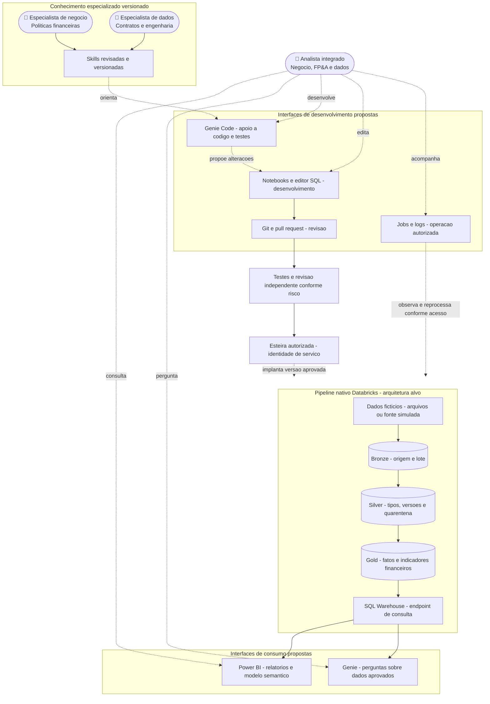
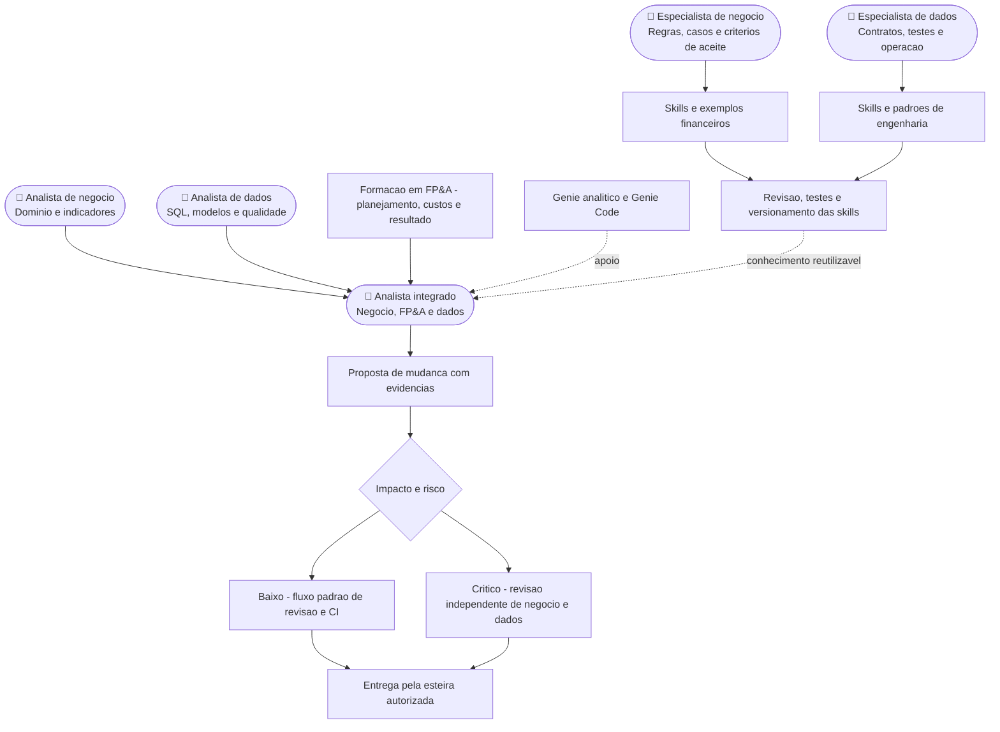

# Arquitetura de interfaces, guardrails e evolução dos papéis

**Comece pela história:** [Do número à decisão](FINANCE_EVOLUTION_STORY.md) apresenta os personagens fictícios, a passagem do tempo, os erros de aprendizagem e a mudança de papéis que motivam esta arquitetura.

## Visão e estado da proposta

**Um mesmo profissional pode combinar análise de negócio, FP&A e dados conforme desenvolve competência demonstrável e recebe acessos compatíveis.** IA apoia essa evolução; guardrails executáveis, evidências e revisão delimitam sua autonomia. Não se trata de atribuir todos os privilégios a uma pessoa.

Esta é uma **arquitetura de referência proposta**, com dados fictícios, independente de qualquer ambiente de empregador. O repositório já contém contrato, backend local, adaptador Spark/Delta, testes e skills em Markdown. Interfaces Power BI/Genie, identidade, esteira de implantação e gates de produção abaixo **não estão implantados ou validados neste laboratório**. Skills são instruções para assistentes; não são controles de acesso nem substituem testes e políticas da plataforma.

## 1. Interfaces de usuário e desenvolvedor

Setas contínuas mostram dados ou etapas de entrega; pontilhadas mostram interação e orientação. As interfaces indicadas são pontos de acesso funcionais, não URLs de serviços já disponibilizados.

**Legenda visual:** cápsulas com 👤 representam pessoas/perfis; 👥 representa um grupo de especialistas. Retângulos representam sistemas, artefatos ou atividades; cilindros representam dados e losangos representam decisões. Vários perfis podem ser exercidos pela mesma pessoa, respeitando os limites de acesso e a revisão independente definidos neste documento.

| Ponto de acesso | Quem usa | Ação e fronteira |
|---|---|---|
| Power BI | Analista/gestor | Consumo de modelo aprovado, com segurança de consumo configurada. Não altera o pipeline. |
| Genie para perguntas de negócio | Analista | Explora dados autorizados; resposta e SQL precisam ser confrontados com controles e definições financeiras. Não equivale a aprovação contábil. |
| Genie Code | Analista habilitado/desenvolvedor | Propõe código, testes e documentação usando skills. Acesso e capacidade de executar dependem das permissões concedidas. |
| Notebooks e editor SQL | Analista habilitado/desenvolvedor | Desenvolvimento e inspeção em ambiente de desenvolvimento. Sem escrita direta em produção no desenho proposto. |
| Git e pull request | Autor, especialista e revisor | Diff, testes e rastreabilidade de código, contratos e skills. Aprovação independente conforme impacto. |
| Jobs e logs | Operador autorizado | Execução e diagnóstico com identidade, parâmetros e permissões definidos. Não concede acesso de edição por si só. |
| SQL Warehouse | Ferramentas e usuários autorizados | Endpoint técnico para consulta: host/HTTP path e autenticação são configurados no ambiente; nenhum endpoint real é publicado aqui. |

O documento usa “Genie para perguntas de negócio” para a interface analítica; nomes como Genie Agents/Spaces dependem da versão disponível. Genie Code é a interface de desenvolvimento. Skills deste projeto destinam-se ao Genie Code, não são automaticamente instruções de um agente analítico.

## 2. Um profissional integrado e dois focos de especialização

O desenho abaixo é uma proposta de organização e capacitação, **não uma previsão comprovada de substituição de cargos**. Uma pessoa pode exercer vários papéis; a organização continua precisando de responsáveis e de independência nas decisões críticas.

| Papel | Conhecimento e responsabilidade | Evidência de competência |
|---|---|---|
| Analista integrado | Formular hipótese, interpretar resultado, escrever transformação e testar mudanças dentro do escopo concedido. | Explica granularidade, regra financeira, SQL produzido pela IA, reconciliação e limitações. |
| Especialista de negócio e skills financeiras | Formalizar políticas e exemplos: competência, alocação, orçamento, sinal, moeda, materialidade e fechamento. | Casos aprovados com resultados esperados independentes, exceções e impacto histórico documentado. |
| Especialista de dados e skills de engenharia | Traduzir requisitos em contratos e padrões operacionais: versões, idempotência, schema, precisão, observabilidade e recuperação. | Testes de regressão/integração, revisão de acesso e comportamento demonstrado diante de falhas. |
| Revisor/aprovador independente | Contestar mudanças materiais e autorizar conforme responsabilidade definida pela organização. | Aprovação atribuída a identidade diferente do autor quando exigido; evidência vinculada à revisão. |

Os dois especialistas colaboram na mesma base de skills; isso não exige duplicar instruções conflitantes. No conjunto atual, `finance-business-rules` concentra regras, `finance-pipeline-maintenance` concentra engenharia e `finance-release-review` integra a revisão dos dois domínios. A autoria da skill também deve passar por avaliação: uma instrução errada pode ser repetida em várias mudanças.

## 3. Guardrails: orientação versus bloqueio real

**A autonomia deve ser concedida por capacidade demonstrada e risco da ação, não pelo título do profissional ou pela disponibilidade de IA.** “Obrigatório na skill” é orientação; “bloqueado pela esteira/plataforma” é enforcement e precisa de implementação própria.

| Camada | Regra proposta | Como bloquear de verdade | Evidência atual / pendência |
|---|---|---|---|
| Identidade e acesso | Consulta e desenvolvimento têm escopos diferentes; escrita produtiva pela esteira. | Grupos, permissões de catálogo/workspace e identidades de serviço; sem segredos em prompts. | Proposta; não configurada no laboratório. |
| Ambiente | Desenvolvimento com dados fictícios; promoção entre ambientes. | Catálogos/locais separados e permissões por ambiente. | Fixtures fictícias disponíveis; isolamento remoto pendente. |
| Contrato e dinheiro | Tipos explícitos, BRL, chave e versão definidas; créditos preservados. | Validador e testes; mudanças incompatíveis exigem migração. | Implementado no escopo documentado do contrato; Delta remoto pendente. |
| Qualidade | Explicar destinos dos registros e reconciliar quantidades/valores conhecidos. | Falhar a tarefa diante de violação crítica. | Controles locais e de transformação presentes; gate de consumo não implantado. |
| IA e contexto | Sugestão é hipótese; conteúdo de dados/logs não é instrução. | Restringir ferramentas/acessos, executar testes e revisar diff/SQL; configuração de permissões fora do prompt. | Orientações nas skills; enforcement remoto pendente. |
| Risco e aprovação | Chave, moeda, alocação, histórico e acesso são mudanças materiais. | Revisores obrigatórios e branch protection conforme política. | Revisão proposta; proteção de branch não configurada por este documento. |
| Entrega e recuperação | Promover só versão aprovada; prever falha parcial. | CI, deployment autorizado e estratégia testada de recuperação/publicação. | Replay local coberto; publicação atômica global não implementada. |
| Consumo | Indicadores com definição, período e fonte; acesso por perfil. | Modelo semântico/RLS no Power BI e permissões de consulta no Databricks. | Interfaces e segurança de consumo propostas, não implantadas. |

Para uma mudança crítica, o autor pode combinar negócio e dados, mas não deve aprovar sozinho sua própria alteração. Ter duas skills não equivale a ter dois revisores independentes.

## 4. Formação e limites progressivos

| Etapa | Analista que vem de negócio | Analista que vem de dados | Autonomia possível após avaliação |
|---|---|---|---|
| Fundamentos | Aprender granularidade, SQL, qualidade e origem dos números. | Aprender competência, orçamento, custos, drivers e interpretação de resultado. | Consultar e validar análises em dados aprovados. |
| Aplicação assistida | Desenvolver transformações simples com Genie Code e testes. | Formalizar regra financeira com exemplos e contraprovas. | Propor mudanças em desenvolvimento e abrir PR. |
| Integração | Demonstrar leitura crítica do código, exceções e reconciliação. | Demonstrar análise de variações e distinção entre hipótese e causa comprovada. | Manter componentes dentro do domínio e acesso concedidos. |
| Especialização | Aprofundar políticas e avaliação de skills financeiras. | Aprofundar contratos, arquitetura e avaliação de skills técnicas. | Construir padrões e revisar mudanças de terceiros conforme responsabilidade. |

Não há progressão automática por tempo de curso. Avalie um caso prático: o profissional explica a regra, testa um contraexemplo, reconcilia o resultado e descreve o que a IA não verificou. IA não substitui domínio de negócio nem responsabilidade financeira.

## 5. Exemplo de ponta a ponta

1. O analista identifica uma variação de custo no Power BI ou por pergunta ao Genie e confere período, escopo e dado usado.
2. Investiga a hipótese: uma divergência pode ser volume, preço, alocação ou qualidade; o gráfico sozinho não demonstra a causa.
3. Se houver necessidade de mudar regra, usa Genie Code com a skill financeira para explicitar exemplos, impacto e alternativas.
4. Com a skill de manutenção, implementa uma mudança mínima em desenvolvimento e testa tipagem, versões, replay e totais.
5. Os especialistas revisam o domínio afetado. Mudança material recebe aprovação independente antes de promoção.
6. A esteira autorizada executa as verificações e libera a versão; consumo é atualizado somente conforme o mecanismo de publicação implementado.
7. A equipe incorpora o aprendizado à skill, revisa a alteração e registra revisão, evidências e limitações para o próximo profissional.

## Referências e documentos relacionados

- [Genie Code: assistente para desenvolvimento](https://learn.microsoft.com/en-us/azure/databricks/genie-code/).
- [Genie Agents: perguntas de negócio sobre dados](https://docs.databricks.com/aws/en/genie-agents/).
- [Skills do Genie Code e registro de pastas](https://learn.microsoft.com/en-us/azure/databricks/genie-code/skills).
- [Guia de uso das skills deste projeto](GENIE_CODE_HANDOVER.md).
- [Escopo e evidências do pipeline](../README.md).

Referências de produto consultadas em 2026-11-22. A proposta de papéis, formação e guardrails é uma decisão de arquitetura deste laboratório, não uma garantia fornecida pelo fabricante.
