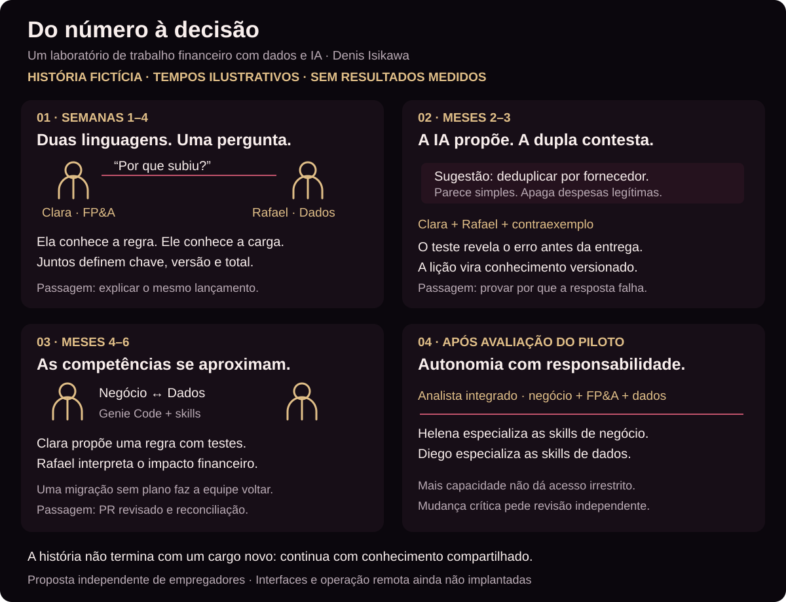
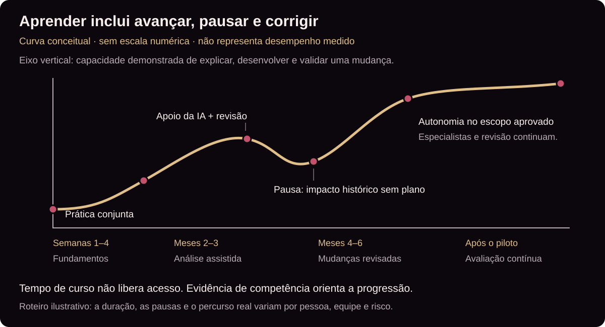
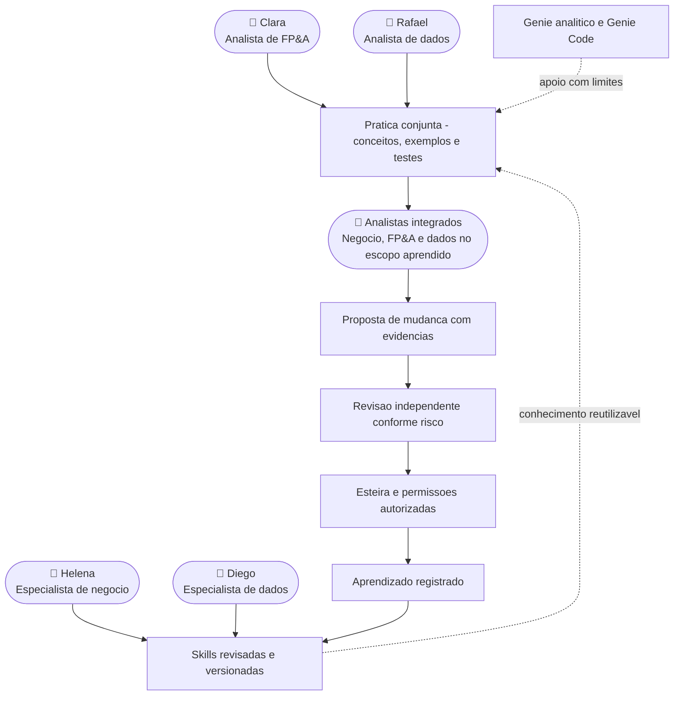

# Do número à decisão: uma jornada de aprendizagem financeira

**Uma história fictícia para explorar uma forma de trabalhar com finanças, dados e IA.** Proposta autoral em evolução no laboratório de Denis Isikawa; não descreve uma implantação no Bradesco ou em qualquer empregador. Os personagens, acontecimentos e prazos são ilustrativos. Não há resultado de produtividade ou redução de equipe medido.

## O começo: duas pessoas e uma pergunta

Na área financeira da fictícia Aurora Serviços, **Clara**, analista de FP&A, prepara a reunião de orçamento. Ela conhece contratos, centros de custo e o calendário de fechamento. **Rafael**, analista de dados, mantém as transformações que alimentam os relatórios. Ele conhece chaves, versões e cargas, mas ainda não domina todas as regras financeiras.

Clara pergunta: **“Por que o custo de nuvem aumentou?”** O relatório confirma a variação; não explica sua causa. Rafael encontra um lançamento atualizado e duas linhas parecidas. Clara sabe que um crédito pode ser legítimo. Nenhum dos dois consegue resolver tudo apenas com sua especialidade.

A primeira decisão da equipe é criar uma linguagem comum: o que identifica um lançamento, qual versão vale, o que é competência e como os totais devem reconciliar. A proposta começa com essa conversa, antes da IA.

## Ato 1 — Construir a ponte · semanas 1–4

Clara aprende a ler uma consulta SQL e a distinguir uma transação de uma agregação mensal. Rafael acompanha uma análise de orçamento e descobre por que rejeitar todo valor negativo apagaria créditos válidos.

Eles registram exemplos em dados fictícios. O primeiro exercício é pequeno e verificável: uma transação de R$ 100,00 atualizada para R$ 120,00 deve deixar **R$ 120,00** na visão atual. Não R$ 220,00. Reenviar o lote não deve alterar esse total. O exercício testa engenharia e interpretação financeira ao mesmo tempo.

**Porta de passagem:** ambos explicam a chave, a versão vencedora e a reconciliação sem depender da resposta do assistente. Se não conseguem, continuam praticando; a semana do calendário não libera acesso.

## Ato 2 — Aprender a contestar a IA · meses 2–3

O desenho futuro introduz duas portas. Pelo **Genie analítico**, Clara explora os dados aprovados. Pelo **Genie Code**, a dupla pede ajuda para ler e alterar código em desenvolvimento. São usos diferentes, sujeitos às permissões do ambiente.

Em um exercício da história, a IA sugere “remover duplicatas por mês, categoria e fornecedor”. A consulta parece razoável, mas eliminaria transações legítimas. Rafael identifica o problema técnico; Clara mostra duas despesas diferentes do mesmo fornecedor. A sugestão é recusada.

O aprendizado aparece justamente nessa pausa: eles já conseguem explicar por que uma resposta convincente está errada. A equipe transforma o contraexemplo em teste e acrescenta a orientação à skill. A IA ajuda a produzir; evidência e revisão decidem se a proposta serve.

**Porta de passagem:** cada profissional reproduz um erro com dados fictícios, avalia a sugestão e demonstra um teste que distingue o comportamento correto do incorreto.

## Ato 3 — Trocar conhecimento, mudar a atuação · meses 4–6

Clara começa a propor uma mudança simples de categoria com contrato e testes. Rafael passa a investigar variações de realizado versus orçamento, diferenciando contribuição aritmética de causa operacional comprovada. Os dois aproximam-se do perfil de **analista integrado de negócio, FP&A e dados**, sem a obrigação de dominar toda a plataforma.

O especialista financeiro **Helena** ajuda a transformar políticas em exemplos, exceções e critérios de aceite. O especialista de dados **Diego** mantém padrões de schema, precisão, reprocessamento e diagnóstico. Eles revisam skills como revisariam código: instruções erradas também se propagam.

O caminho inclui uma volta: ao mudar uma chave, a dupla percebe que os testes simples passam, mas a migração histórica não foi definida. A entrega fica retida até que o impacto e a recuperação sejam demonstrados. O tempo gasto nessa etapa não é fracasso; é parte da aprendizagem.

**Porta de passagem:** alteração em desenvolvimento, exemplos financeiros aprovados, testes relevantes e revisão por outra pessoa. Mudanças de chave, moeda, alocação ou histórico exigem análise especializada.

## Ato 4 — Autonomia delimitada, conhecimento compartilhado · após o piloto

Clara e Rafael podem consultar, investigar e propor evoluções dentro de seus escopos. A dupla não precisa abrir um chamado para toda dúvida, mas também não ganha escrita irrestrita em produção. A esteira e as permissões continuam delimitando a ação.

Helena aprofunda as **skills de negócio**; Diego aprofunda as **skills de engenharia**. O papel especialista ganha alcance: um aprendizado revisado pode orientar várias pessoas e várias mudanças. As responsabilidades podem se combinar em equipes pequenas, mas aprovação independente de mudança crítica não se resolve fazendo o autor trocar de “chapéu”.

A reunião financeira passa a ter uma ambição diferente: discutir o número com origem, regra, hipótese e limites explícitos. **Essa é a hipótese de valor do framework, não um benefício já medido.**

## A curva: aprender não é uma linha reta

O desenho mostra uma **trajetória conceitual**, não uma pesquisa, previsão estatística ou pontuação de pessoas. As faixas de tempo são um roteiro inicial de piloto; cada equipe pode avançar, pausar ou retornar. Autonomia depende de evidência de competência e dos acessos autorizados, nunca apenas de tempo de curso.

| Momento ilustrativo | Clara, vindo de FP&A | Rafael, vindo de dados | Entrega observável |
|---|---|---|---|
| Semanas 1–4 | SQL básico, granularidade e origem | Competência, créditos e orçamento | Explicam o mesmo lançamento e total |
| Meses 2–3 | Ler SQL gerado e contestar respostas | Validar hipótese financeira com evidência | Contraexemplo e teste de regressão |
| Meses 4–6 | Propor regra simples testável | Analisar variação com contexto de negócio | PR revisado e reconciliação |
| Após avaliação do piloto | Manutenção no escopo concedido | Atuação financeira no domínio aprendido | Mudança rastreável e recuperação demonstrada |

Os períodos não representam carga de treinamento, custo, prazo contratual ou garantia de formação. Conhecimento prévio e complexidade alteram o percurso.

## Como os papéis se reorganizam

**Legenda:** cápsulas com pessoa/grupo representam perfis; retângulos representam atividades ou artefatos. Os nomes são fictícios e não correspondem a funções reais de uma organização específica.

## Guardrails dentro da história

| Cena | Limite | Onde precisa existir |
|---|---|---|
| A IA sugere eliminar linhas legítimas | Contraexemplo, teste e revisão impedem aceitar a proposta sem evidência. | Código de testes e processo de revisão; a skill orienta. |
| Clara aprende a escrever código | Competência para propor não implica permissão para publicar. | Acessos de desenvolvimento e proteção da esteira. |
| Rafael muda uma regra com efeito financeiro | O autor não aprova sozinho alteração material. | Revisão independente e critérios de negócio. |
| Uma entrega muda dados históricos | Backfill, reconciliação e recuperação precisam ser definidos. | Procedimento e testes no runtime de destino. |
| Uma resposta analítica parece explicar a causa | Variação calculada não comprova causalidade. | Fonte identificada, investigação e revisão financeira. |
| Uma skill é atualizada | O próprio conhecimento reutilizável pode estar errado. | Versão, casos de avaliação e revisão das skills. |

Veja a [matriz técnica de guardrails](ARCHITECTURE_AND_ROLES.md#3-guardrails-orientação-versus-bloqueio-real) para distinguir controles existentes de enforcement ainda proposto.

## O que esta história acrescenta ao projeto

| Artefato | Estado |
|---|---|
| Contrato financeiro, backend local, testes e adaptador Spark/Delta | Código existente; limites de execução no [README](../README.md). |
| Skills de regras, manutenção e revisão | Arquivos disponíveis no repositório; registro e uso no Genie Code não validados. |
| História, desenhos e roteiro de formação | Documentação ilustrativa criada para explicar a proposta. |
| Integração Genie/Power BI, formação de equipe e produção governada | Arquitetura alvo; não executada por esta narrativa. |
| Ganho de produtividade, redução de erros ou mudança de cargos | Hipóteses; nenhuma medição organizacional realizada. |

## Próximo experimento: aprender com um caso pequeno

Conduzir um piloto fictício de evolução de categoria usando a skill `finance-business-rules`. Registrar a regra e os testes esperados antes da mudança; avaliar se o participante encontra uma sugestão incorreta e consegue justificar a correção. Revisar o diff com outra pessoa.

Medir, se o piloto for realizado: tempo até uma alteração revisada, retrabalho solicitado, erros encontrados e compreensão demonstrada. Registrar cenário e apoio recebido; não comparar pessoas por um escore inventado. Só publicar resultados depois da execução, sem generalizar o desempenho de um exercício para uma organização.

**Explore:** [arquitetura e interfaces](ARCHITECTURE_AND_ROLES.md) · [usar as skills com Genie Code](GENIE_CODE_HANDOVER.md) · [código e limites de validação](../README.md).
