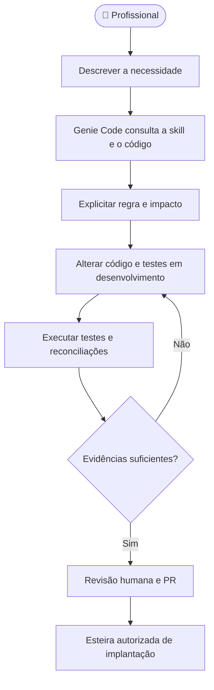

# Evolução assistida com Genie Code

Este template entrega código de pipeline e conhecimento de manutenção versionado para o próximo profissional. Três skills transversais orientam alterações de regras, correções e revisão; seis especializações adicionais separam guardrails de dados e conhecimento de FP&A. Elas não substituem controles executáveis, revisão humana ou a esteira adotada pela organização.

Veja também a [arquitetura de interfaces, papéis e guardrails](ARCHITECTURE_AND_ROLES.md): o analista integrado pode combinar negócio, FP&A e dados, com especialistas mantendo as skills financeiras e técnicas e revisão independente nas mudanças críticas.

**Estado:** skills e guia disponíveis no repositório; uso em Genie Code/workspace ainda não validado. Nenhuma skill foi instalada globalmente nem registrada em um workspace nesta entrega. O laboratório usa dados fictícios e não reproduz sistemas internos de empregadores.

## Qual Genie?

**Genie Code** é o assistente de desenvolvimento usado nesta proposta. Um **Genie Space** atende perguntas sobre dados; não é o destino destas instruções de manutenção. Este trabalho não altera o projeto separado `ai-agent-fpa-query`.

## Preparar no Databricks

1. Disponibilize o checkout em uma Databricks Git folder e confira a revisão usada.
2. No Genie Code, abra **Customizations → Skills → New → Add from workspace folder** e selecione a pasta pai `databricks-pipeline-template/skills`, para as três entradas transversais. Registre também `skills/data-guardrails` e `skills/fpa-business`, cada qual contendo três skills especializadas. Não presuma descoberta recursiva. Não selecione um `SKILL.md` isolado. Essa configuração registra as skills para o usuário; não as publica para todos.
3. Alternativamente, use **Upload from computer** com as pastas das skills. Skills de workspace devem ser disponibilizadas pelo administrador conforme os controles da organização. Não substitua uma skill compartilhada de mesmo nome sem revisar o impacto.
4. Confira se as skills aparecem e faça referência com `@` no chat. Deixe o código e os testes acessíveis ao assistente; a skill não contém uma cópia deles.
5. Teste primeiro em ambiente de desenvolvimento com entradas fictícias. Após editar uma skill, abra um novo chat para carregar a revisão.

Procedimento baseado na [documentação oficial de skills do Genie Code](https://learn.microsoft.com/en-us/azure/databricks/genie-code/skills), consultada em 2026-11-22. Disponibilidade e permissões devem ser verificadas no workspace de destino. Não se presume descoberta automática apenas por clonar este repositório.

Consulte o [catálogo por domínio e os casos de avaliação](SKILL_CATALOG.md) para selecionar as especializações sem carregar toda a biblioteca.

## Escolher a skill

| Necessidade | Skill | Resultado esperado |
|---|---|---|
| Nova categoria, regra de competência ou tratamento financeiro | `finance-business-rules` | Contrato explícito, código e testes com valores esperados |
| Falha, refatoração, retry ou problema de processamento | `finance-pipeline-maintenance` | Reprodução, correção e evidência de regressão |
| Avaliar uma mudança antes da entrega | `finance-release-review` | Achados, testes, pendências e limites de validação |

## Fluxo de trabalho



**Legenda:** a cápsula com 👤 identifica a pessoa; os retângulos identificam as atividades do fluxo.

## Solicitações reproduzíveis

### Evoluir regra

> Use @finance-business-rules neste checkout. Aceite NETWORK como categoria, sem alterar as atuais. Primeiro mostre os exemplos esperados; depois implemente validação e testes para valor válido, inválido, duplicata e replay. Preserve BRL, créditos e reconciliação. Não execute escrita remota.

### Fazer manutenção

> Use @finance-pipeline-maintenance. Reproduza a chegada de uma versão antiga depois da atual com dados fictícios. Confira que a versão atual e o total Silver não retrocedem. Corrija somente se houver defeito e apresente os testes executados.

### Revisar a entrega

> Use @finance-release-review para revisar o diff atual. Procure mudanças indevidas de chave, precisão, deduplicação e descarte de registros. Separe evidências locais, Spark e Delta/workspace. Não publique nem execute jobs remotos.

Esses prompts são exemplos de uso; NETWORK não foi acrescentada ao contrato por este documento.

## Executar e registrar as verificações

Da raiz do repositório, em ambiente com pytest:

```bash
python -m pytest tests/test_pipeline_contract.py -q
```

Para a transformação Spark, instale os requisitos opcionais de `databricks-pipeline-template/requirements-spark.txt` em ambiente apropriado com Java 17. Em PowerShell:

```powershell
$env:RUN_SPARK_TESTS = '1'
python -m pytest tests/test_pipeline_contract.py tests/test_pipeline_spark.py -q
```

No Bash, use `RUN_SPARK_TESTS=1 python -m pytest tests/test_pipeline_contract.py tests/test_pipeline_spark.py -q`.

O workflow `.github/workflows/data-reliability.yml` configura esse teste de transformação; ele não comprova JDBC, MERGE Delta, permissões ou implantação em Databricks. A validação dessas integrações exige ambiente próprio e autorização para execução. Não trate geração de código como execução bem-sucedida.

No handover registre revisão Git, regra solicitada, arquivos alterados, exemplos esperados, comandos e resultados, verificações não realizadas, efeito histórico e recuperação. Anexe evidência de runtime quando existir. Não exponha segredos nem conteúdo de clientes/empregadores ao assistente ou ao repositório público.
