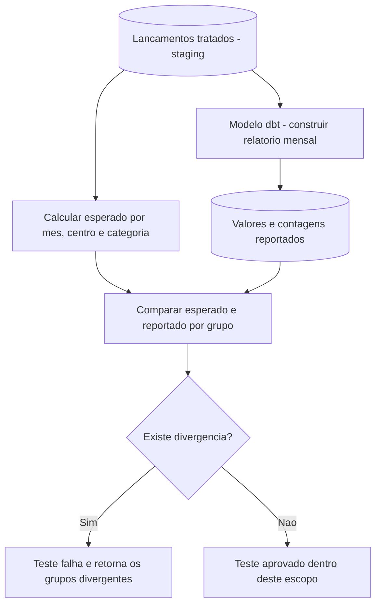

# O total bateu. O relatório estava errado.

## Um caso de FP&A sobre reconciliação no nível da decisão

**Finance Analytics Engineering Lab · dbt + DuckDB · dados fictícios**

Este laboratório demonstra por que conferir apenas o total de um relatório pode
não ser suficiente. O caso abaixo é reproduzível com o SQL do projeto: duas
alocações incorretas se compensam no consolidado, mas distorcem a visão das áreas.
Não é um incidente real nem uma implantação em empregador.

**Leia em três níveis:** [entenda o problema](#1-o-problema-que-o-total-esconde)
· [veja o controle](#3-como-o-controle-encontra-o-erro)
· [execute o exemplo](#5-reproduza-o-caso).

## 1. O problema que o total esconde

Imagine uma reunião mensal de custos. Tecnologia espera reconhecer R$ 40 mil;
Operações, R$ 60 mil. O relatório apresenta R$ 50 mil para cada área.

| Centro de custo | Valor esperado | Valor no relatório | Diferença: relatório − esperado |
|---|---:|---:|---:|
| Tecnologia | R$ 40.000,00 | R$ 50.000,00 | +R$ 10.000,00 |
| Operações | R$ 60.000,00 | R$ 50.000,00 | −R$ 10.000,00 |
| **Total** | **R$ 100.000,00** | **R$ 100.000,00** | **R$ 0,00** |

A conferência do consolidado aprova os R$ 100 mil. Entretanto, a distribuição
por centro de custo está errada. Se a conversa de orçamento acontece por área,
um gestor pode investigar um aumento inexistente enquanto outro deixa de
questionar uma despesa atribuída a menos.

**A reconciliação precisa acompanhar o nível em que a decisão é tomada.**
Neste exemplo, a diferença absoluta soma R$ 20 mil entre os dois grupos, mas isso
não significa R$ 20 mil de perda: é a contagem dos dois lados de uma distorção
compensatória de R$ 10 mil. Não se deve transformar esse número em economia ou
exposição financeira sem um critério próprio.

O exemplo mantém o mesmo mês (janeiro de 2026), categoria (Cloud), moeda (BRL)
e quantidade de transações. Só a distribuição dos valores é alterada.

## 2. O que significa reconciliar neste projeto

**Grão** é o nível de detalhe de uma linha. Uma linha do relatório representa:

> mês × centro de custo × categoria

Para cada combinação, o controle compara a soma dos lançamentos tratados com a
soma reportada, além da quantidade de transações. Não basta que o total geral
bata: todos os grupos esperados precisam existir e nenhum grupo inesperado pode
aparecer.



O dbt organiza os modelos e executa o teste; o **DuckDB processa o SQL localmente**.
A integração com Databricks não foi executada. O desenho não representa uma
publicação governada de Power BI já implantada.

## 3. Como o controle encontra o erro

O teste [assert_monthly_costs_reconcile.sql](tests/assert_monthly_costs_reconcile.sql)
usa um `FULL OUTER JOIN`: preserva grupos dos dois lados da comparação. Um
`INNER JOIN` sozinho poderia esconder justamente um grupo que desapareceu.

Este é o trecho central do SQL real:

```sql
from expected e
full outer join actual a
  on e.month = a.month
 and e.cost_center = a.cost_center
 and e.category = a.category
where e.expected_transaction_count is null
   or a.actual_present is null
   or a.total_amount_brl is null
   or a.transaction_count is null
   or e.expected_amount_brl <> a.total_amount_brl
   or e.expected_transaction_count <> a.transaction_count
```

No dbt, um teste de dados retorna as linhas que violam sua regra. **Zero linhas
significa aprovação; linhas retornadas representam falhas.** O teste completo
inclui mês, centro, categoria, valores e contagens dos dois lados para investigação.

Os valores usam `decimal(18,2)` e a comparação é exata neste contrato BRL. Não há
tolerância para esconder centavos nem conversão implícita de moedas. As contagens
complementam o valor: duas alterações podem preservar a soma e mudar o número de
transações.

## 4. Evidência: testar o controle, não apenas o caminho feliz

O [verificador de corrupções](scripts/check_reconciliation_mutations.py) executa o
SQL compilado pelo dbt sobre cópias isoladas em memória. A base construída pelo
dbt é anexada somente para leitura. Cada alteração deliberada é desfeita antes do
próximo cenário.

| Cenário provocado | Por que importa | Comportamento verificado |
|---|---|---|
| Grupo ausente | Uma área/categoria pode desaparecer | Retorna o grupo sem correspondência |
| Grupo inesperado | Um grupo extra pode contaminar o relatório | Retorna o grupo não previsto |
| Diferença de R$ 0,01 | Arredondamento ou transformação pode alterar valor | Retorna a diferença |
| Contagem incorreta | Valor sozinho não garante completude | Retorna a divergência de contagem |
| Valor nulo | Ausência não equivale a zero | Retorna a medida ausente |
| Contagem nula | Falta de medida também é inconsistência | Retorna a medida ausente |
| +R$ 0,01 em um grupo e −R$ 0,01 em outro | O total geral não revela o erro | Retorna as diferenças por grupo |

O [exemplo de R$ 100 mil](scripts/demonstrate_offsetting_errors.py) é uma segunda
fixture didática, separada do CSV padrão: quatro lançamentos em memória alimentam
**o modelo compilado real**, depois o relatório recebe +R$ 10 mil em Tecnologia
e −R$ 10 mil em Operações. O controle compilado deve retornar exatamente as duas
divergências da tabela inicial. Ele não abre nem altera uma base persistente.

### Resultado observado

Em 23/11/2026: build local concluído com **15 testes de dados aprovados**, dois
modelos e um seed; os sete cenários de corrupção foram detectados. O exemplo de
R$ 100 mil também foi executado: o total permaneceu R$ 100 mil e o teste retornou
os dois grupos incorretos. As falhas são deliberadas e capturadas pelo verificador;
não são erros pendentes no build normal.

Consulte a [CI específica do laboratório](https://github.com/denisisikawa/business-science-lab/actions/workflows/dbt-finance-ci.yml)
para o resultado da revisão atual e o [registro de validação](../DATA_RELIABILITY_VALIDATION.md)
para ambiente e limites. Um workflow de outra revisão não prova esta revisão.

### Um segundo ponto cego: os dois lados podem perder o mesmo mês

A reconciliação staging × mart passa se os dois lados perderem o mesmo grupo.
Por isso o laboratório agora mantém um [escopo de reporte independente](seeds/finance_reporting_scope.csv):
18 combinações fictícias de mês × centro × categoria esperadas entre janeiro e
março de 2026. O escopo foi declarado para o caso, não extraído dos fatos que chegaram.

O [controle de cobertura](tests/assert_reporting_scope_coverage.sql) compara cada
grupo esperado com as duas camadas, identifica a presença em cada uma e também
retorna grupos inesperados. Outro [teste](tests/assert_reporting_scope_valid.sql)
rejeita escopo duplicado, mês fora do primeiro dia e atributos vazios.

O [verificador de cobertura](scripts/check_reporting_scope_mutations.py) comprova
sete cenários de perda/inclusão e três corrupções do escopo, em memória. Ao apagar
fevereiro dos dois lados, a reconciliação antiga continua aprovando os grupos
restantes; a nova cobertura aponta **seis grupos ausentes**. Com ambos os fatos
vazios, aponta os **18 grupos esperados**.

Em 25/11/2026, o build local passou com **20 testes de dados, dois modelos e dois
seeds**. Os dez cenários adicionais passaram, assim como os sete cenários de
reconciliação anteriores e o exemplo de R$ 100 mil. Isso é evidência da fixture,
não um calendário corporativo completo, controle de freshness ou SLA implantado.
O escopo também pode estar errado: sua manutenção precisa de revisão de negócio.

## 5. Reproduza o caso

Python 3.11+ recomendado. Da raiz do repositório:

```bash
cd dbt-finance-lab
python -m venv .venv
# Windows PowerShell: .venv\Scripts\Activate.ps1
# macOS/Linux: source .venv/bin/activate
python -m pip install -r requirements-dbt.txt
```

Copie `profiles.example.yml` para `profiles.yml` (`Copy-Item` no PowerShell ou `cp`
no Bash). O perfil local é ignorado pelo Git e não requer credenciais de nuvem.

```bash
dbt debug --profiles-dir .
dbt build --profiles-dir .
python scripts/demonstrate_offsetting_errors.py
python scripts/check_reconciliation_mutations.py
python scripts/check_reporting_scope_mutations.py
# Opcional: gerar a documentação de dependências
dbt docs generate --profiles-dir .
```

Trecho esperado do exemplo didático, depois de um build bem-sucedido:

```text
Operacoes | 60000.00 | 50000.00 | -10000.00
Tecnologia | 40000.00 | 50000.00 | +10000.00
Grand total before: 100000.00; after: 100000.00
PASS: total-only comparison misses the error; compiled dbt control returns 2 failing groups
```

O seed padrão contém **18 lançamentos fictícios** e continua independente dessa
fixture de quatro linhas. Os scripts dependem de `target/manifest.json` e dos
arquivos compilados pelo build anterior; não substituem um `dbt build` completo.
Se mudar o perfil/schema/caminhos, revise a configuração dos verificadores locais.

## 6. Onde esse controle ajuda — e onde não ajuda

**Ajuda:** detectar perda, inclusão ou alteração indevida entre o staging e o mart,
no grão definido. Dá uma evidência verificável para discutir a integridade da
transformação antes de usar o resultado em uma análise de FP&A.

**Não garante:** que o lançamento de origem esteja correto. Se o centro de custo
já estiver errado no staging e o mart reproduzir o mesmo erro, a comparação passa.
É necessário um controle independente de cadastro, classificação, contrato ou
razão contábil para validar esse significado de negócio.

Também não garante:

- Identidade de cada transação: valores e contagens iguais podem esconder trocas
  entre registros dentro do mesmo grupo. Os testes de chave são complementares.
- Completude universal ou freshness: a reconciliação sozinha não detecta perdas
  compartilhadas. O novo controle cobre os grupos declarados no escopo fictício,
  mas não prova que o escopo está correto, nem verifica horário de entrega/SLA.
- Política contábil completa: a restrição existente de custo mensal positivo é
  específica do seed. Créditos líquidos e estornos exigem uma política própria.
- Segurança de acesso, publicação atômica ou execução em Databricks/Power BI.
- Precisão universal, economia, escala ou ganho de produtividade em produção.

**IA pode ajudar a escrever o SQL. Ela não escolhe, sozinha, qual nível de
reconciliação representa a decisão financeira nem comprova a qualidade da origem.**

## 7. Mapa técnico do laboratório

| Artefato | Responsabilidade |
|---|---|
| [Seed sintético](seeds/finance_costs.csv) | Entrada padrão, sem dados corporativos |
| [Staging](models/staging/stg_finance_costs.sql) | Casts e padronização |
| [Mart mensal](models/marts/fct_monthly_costs.sql) | Valores e contagens no grão financeiro |
| [Testes de schema](models/schema.yml) | Unicidade, obrigatoriedade e categorias |
| [Teste de reconciliação](tests/assert_monthly_costs_reconcile.sql) | Comparação exata por grupo |
| [Escopo independente](seeds/finance_reporting_scope.csv) | Grupos esperados, separados dos fatos |
| [Cobertura](tests/assert_reporting_scope_coverage.sql) | Presença esperada em staging e mart |
| [Desenho técnico detalhado](docs/RECONCILIATION_DESIGN.md) | Decisões, falhas e investigação |
| [Workflow](../.github/workflows/dbt-finance-ci.yml) | Build e exemplos negativos em CI |

## 8. Próxima evolução, sem misturar escopos

- [x] Staging tipado, mart mensal e testes de schema.
- [x] Reconciliação de valores/contagens e sete cenários de corrupção.
- [x] Exemplo didático de erros compensatórios usando SQL compilado.
- [ ] Realizado versus orçamento com granularidade explícita.
- [x] Cobertura por escopo independente no caso fictício janeiro–março/2026.
- [ ] Calendário fiscal completo/freshness; dimensões e integridade referencial.
- [ ] Histórico, incrementais e política de reprocessamento.
- [ ] Adaptador Databricks e execução real em ambiente autorizado.

O projeto incorpora princípios de **FP&A**; **RevenueGuard permanece separado**.
A integração Databricks/Unity Catalog é futura e não é requisito para reproduzir
este caso local. Não há certificação ou implantação empresarial reivindicada.

[Documentação oficial de testes dbt](https://docs.getdbt.com/docs/build/data-tests)
· [Roteiro de estudos](CERTIFICATION_ROADMAP.md)

**Confidencialidade:** dados, entidades e resultados são fictícios. Este trabalho
é independente do Bradesco e de qualquer empregador. Não publique credenciais,
arquitetura interna, dados de clientes ou capturas confidenciais.
