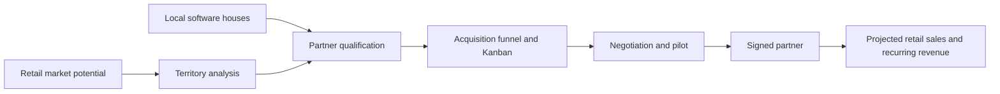

# Franchise Expansion Intelligence
## Territory Analytics & Partner Acquisition

**v0.2 — independent synthetic case study.** This scenario is inspired by challenges in retail software distribution and franchise network expansion. No employer data, actual prospect lists, real partner identities or commercial results are used.

## Business problem
A fictional retail-software vendor needs to scale its sales and implementation network without opening branches in every territory. Local software houses may become franchisees or authorized channel partners. Potential retail customers create a demand signal; partner acquisition is a separate B2B pipeline.

## Decision flow

## Demo
[Open interactive sandbox](https://denisisikawa.github.io/denis-isikawa-databricks/franchise-expansion-sandbox/)

The browser-only demo uses a seeded synthetic population with approximate geographic anchors across Greater São Paulo, straight-line distance calculations, territory coverage, opportunity allocation, an editable partner Kanban, per-partner staffing and coverage parameters, capacity bottlenecks and indicative revenue projections. No map API, credentials, server or paid hosting required. The coordinate plot is schematic, not a road or administrative boundary map.

## Scope
- Retail leads: fictional stores, geography, vertical, illustrative monthly software subscription value (BRL).
- Partner leads: fictional local software houses, location, fit score, pipeline stage.
- Territory: adjustable radius, vertical filters, overlapping coverage deduplicated by nearest eligible partner.
- Forecast: explicit per-partner headcount, sales FTE, radius, productivity and conversion; expected sales limited by territorial demand and monthly capacity; end-horizon MRR and open probability-weighted pipeline separated.
- Kanban: stage changes in memory during current session only. Signed and lost are terminal states in the demo; users may reclassify for scenario testing.

See [methodology](docs/methodology.md). A legal Brazilian franchise model, distribution agreement, licensing terms and commercial due diligence require separate review. This demo does not establish an actual franchise relationship.
