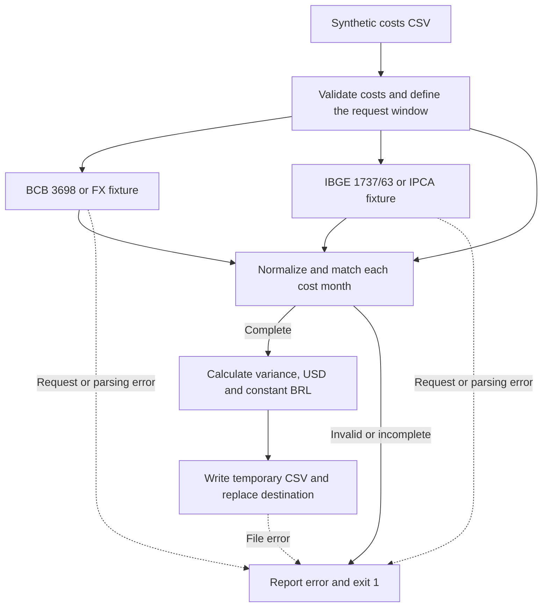

# Macro context for FP&A

A monthly report that combines a synthetic cost and budget series with Brazilian exchange rates and inflation. It lets a reviewer inspect budget variance, an indicative USD view and actual costs in constant BRL side by side.

## Implementation plan

1. Use two public, credential-free sources with monthly grain and document the series and units.
2. Retrieve the requested window in Python. Validate uniqueness, contiguous cost months and match coverage before writing the CSV.
3. Calculate budget variance, USD equivalents and inflation-adjusted actual costs. Supply mocked API responses for reproducible review.
4. Add an executive view and a technical view to the bilingual portfolio, then validate the report and page.

## Sources

| Provider | Series | Unit | Role |
| --- | --- | --- | --- |
| [Banco Central do Brasil, SGS](https://www3.bcb.gov.br/sgspub/) | 3698, USD selling rate, monthly average | BRL per USD | Approximate USD equivalent for monthly costs |
| [IBGE SIDRA](https://sidra.ibge.gov.br/tabela/1737) | Table 1737, variable 63, national IPCA monthly change | Percent | Convert nominal costs to first-month prices |

The input CSV contains one synthetic row per month. Both sources are joined to that month. A month can be over while its IPCA release is still pending. Use a window covered by both providers. Source revisions may change results across live reruns.

## Published example

The [downloadable report](../docs/data/fpa-official-2025-q1.csv) uses synthetic costs and budgets, monthly USD selling-rate averages sourced from [AEPS 47.4, which credits Banco Central do Brasil](https://www.gov.br/previdencia/pt-br/assuntos/previdencia-social/arquivos/copy_of_aeps-2025/secao-xv-indicadores-economicos/capitulo-47-indicadores-economicos/47-3-taxa-de-venda-de-dolar-r), and IPCA from the [IBGE December 2025 bulletin](https://ftp.ibge.gov.br/Precos_Indices_de_Precos_ao_Consumidor/IPCA/Fasciculo_Indicadores_IBGE/ipca-inpc_202512caderno.pdf). The values were transcribed into local JSON in the providers' expected shapes.

| Month | USD selling rate average (BRL/USD) | IPCA monthly (%) |
| --- | ---: | ---: |
| 2025-01 | 6.0218 | 0.16 |
| 2025-02 | 5.7656 | 1.31 |
| 2025-03 | 5.7468 | 0.56 |

```bash
python macro-fpa/report.py --costs macro-fpa/example/costs.csv --fixtures macro-fpa/example/official-2025-q1 --output macro-report.csv
```

## Cost intelligence

[`intelligence.py`](intelligence.py) reconciles synthetic category detail to each monthly control total before ranking costs or drafting commentary. Run it for the full period or use `--month 2025-03` for a monthly view.

```bash
python macro-fpa/intelligence.py --costs macro-fpa/example/costs.csv --detail macro-fpa/example/cost-detail.csv --output cost-intelligence.json
```

- **ABC** ranks categories by actual costs, descending. Categories enter A while prior cumulative spend is below 80%, B while it is below 95%, and C afterward. The category that crosses a threshold stays in its starting class. Ties are ordered by category name. Zero-cost categories are C when the total is positive. When the total is zero, the share and class are undefined.
- **Variance bridge** reports actual minus budget, total unfavorable and favorable contributions, and percentage variance when the budget is positive. The drivers are arithmetic contributions. Evidence such as invoice lines, service usage, rates and accrual timing is needed to verify an operational cause.
- **Commentary** produces English and Portuguese from the same calculated facts. The portfolio [JSON example](../docs/data/fpa-intelligence-q1.json) uses the default rules mode.

### Banking cost-to-serve methodology

The [card dispute costing design (PT-BR)](BANKING_COSTING.md) specifies direct assignment, TDABC, technology allocation, capacity reconciliation and a worked variance bridge. The worked example uses synthetic inputs and describes a proposed extension of the laboratory.

### AI-assisted commentary

With your own `OPENAI_API_KEY` in the environment, add `--commentary openai` to the command. You can override the default model with `--model`. This opts into an OpenAI Responses API call with the variance summary and category labels. Use synthetic inputs for the public demo. Requests may incur API charges.

The model selects the order of approved facts and an investigation step from a structured schema. Python renders all amounts, category labels and bilingual text. The model's output supplies no numbers or free-form causal assertions. Invalid output and API failures fall back to rules, and `commentary.source` identifies `rules`, `openai`, or `rules_fallback`.

## Technical lineage



| Step | Implementation | Contract |
| --- | --- | --- |
| Read costs | [`read_costs`](report.py) | `month`, `actual_brl`, `budget_brl`. One row per closed calendar month, 1–120 consecutive months, nonnegative costs. |
| Request public data | [`main` and `fetch`](report.py) | The cost window determines both API requests. Each HTTP attempt has a 15-second timeout. Transient errors can trigger two retries. |
| Normalize sources | [`read_fx` and `read_ipca`](report.py) | Convert source periods to month-start dates and amounts to finite decimals. Require positive FX, IPCA above −100% and unique source months. The same parsers read fixtures when explicitly selected. |
| Match and calculate | [`build_report`](report.py) | Match each cost month to both indicators. Emit one sorted row per cost month. Missing observations fail the run. |
| Write | [`write_report`](report.py) | Write the entire CSV to a temporary file in the destination directory, then replace the destination. Failed runs before replacement preserve a previous report. |

### Output columns

| Column | Meaning |
| --- | --- |
| `month` | Monthly key, formatted as YYYY-MM |
| `actual_brl` | Synthetic actual costs in nominal BRL |
| `budget_brl` | Synthetic budget in nominal BRL |
| `variance_brl` | Actual minus budget, in BRL |
| `usd_brl_avg` | Monthly selling-rate average, in BRL per USD |
| `ipca_month_pct` | Monthly IPCA change, in percent |
| `actual_usd` | Indicative equivalent in USD at the monthly average rate |
| `actual_brl_in_first_month_prices` | Actual costs in constant BRL, using the first report month as base |

## Run

Python 3.11+, standard library only. From the repository root:

```bash
# Public API mode
python macro-fpa/report.py --costs macro-fpa/example/costs.csv --output macro-report.csv

# Reproducible mode using simulated API responses
python macro-fpa/report.py --costs macro-fpa/example/costs.csv --fixtures macro-fpa/fixtures --output macro-report.csv

python -m unittest discover -s macro-fpa -p "test_*.py"
```

The program retries transient network errors, fails on missing or duplicate months, and replaces the output only after validation and a complete write. Store reports from the two modes under distinct filenames when comparing them.

## Read the report

- **Budget variance** is actual minus budget. A positive value means spending above budget.
- **Indicative USD** is BRL actual divided by the monthly average FX rate. This estimates a reporting equivalent. Transaction settlement and hedging require their own rates.
- **Constant BRL** is actual divided by the compounded IPCA index, with the first month set to 1. The index compounds from the second month through each reported month. IPCA is a consumer price index used here as a proxy for the purchasing power of these costs.

In the simulated March 2025 row, BRL 105,000 actual versus BRL 106,000 budget gives a BRL 1,000 underspend. At 5.25 BRL per USD, the indicative equivalent is USD 20,000. Two months of 1% simulated inflation put actual costs at BRL 102,931.09 in January prices.

The lab runs locally in Python. The repository's dbt/DuckDB lab and Databricks reference pipeline have their own execution paths.

## Diagram references

- [C4 notation](https://c4model.com/diagrams/notation) informs the diagram scope, boundary, edge labels and legend.
- [Databricks reference architectures](https://learn.microsoft.com/en-us/azure/databricks/lakehouse-architecture/reference) inform the source-to-output layout. The diagram maps that structure to this lab's local Python runtime and CSV output.
