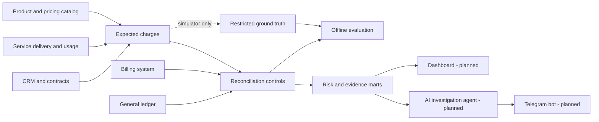

# RevenueGuard AI
## Enterprise Finance Data Simulator & Revenue Assurance Lab

**Status: v0.1 — experimental sandbox.** Independent synthetic-data project. No employer data, infrastructure, claims of realized savings, or production deployment.

### Business problem
A fictional B2B technology provider sells recurring software licenses, managed support, and consumption-based cloud services. CRM, contracts, service fulfillment, billing and general ledger systems can disagree. Revenue assurance reconciles independent evidence and prioritizes exceptions for investigation.

### Objective
Build an auditable, reproducible financial control platform that detects revenue leakage, overbilling and reconciliation gaps; quantifies financial exposure; and uses AI to explain *verified* findings, not invent financial amounts.

### System design


### Current implementation
- Seeded Python generator using only the standard library; CSV output in a chosen local directory.
- Independent customer, product, contract, usage, invoice-item and simplified journal datasets.
- Three mutually exclusive injected billing defects: missing charge, underbilling and overbilling.
- Restricted evaluation labels and generation manifest.
- Integer minor-unit amounts (USD cents); deterministic output for fixed seed/configuration.
- No cloud account, credentials or paid service required for this version.

### Quick start
From the repository root, using Python 3.10+:

```bash
cd revenueguard-ai
python simulator.py --customers 100 --months 12 --seed 42 --output data/generated
python -m unittest discover -s tests -v
```

The generator writes data locally. Do not commit generated datasets or credentials. The full-scale target is 10,000 customers, 12,000 contracts, 25,000 items and approximately one million total rows; this is a roadmap target, not a measured result. The initial generator uses two items per contract and one contract per customer.

### Input reliability before financial calculations

The billing control now validates the four datasets it consumes before building
lookup dictionaries. Duplicate product/item keys, invoice IDs or item-period
keys fail explicitly instead of silently keeping the last CSV row. It also
checks required headers/attributes, CSV row shape, real YYYY-MM periods,
nonnegative integer quantities/charges, positive tariffs/committed quantities,
supported billing models, item/product references and invoice-to-usage evidence.

Structural corruption raises `ValueError` before a result is returned. This is a
fail-closed local control, not a quarantine workflow. Missing invoices remain
valid business exceptions; a zero billed amount remains eligible for underbilling
analysis. The original expected/actual/exposure calculations are unchanged for
valid input. The Python engine bundled in the browser page is synchronized and
checked against the local module.

Scope is deliberately limited: this does not validate contract-to-customer
relationships, contract dates, journal reconciliation, source completeness,
multiple invoices per item-month, credits or multiple currencies. Those require
separate contracts and controls. See the [detailed input boundary](docs/data-model.md#runtime-input-boundary).

### External testing
- [Browser sandbox (GitHub Pages)](https://denisisikawa.github.io/business-science-lab/revenueguard-sandbox/) — standalone Python-in-browser demonstration; public, unlinked from the portfolio landing page.
- [Deployment and acceptance tests](docs/external-testing.md) — optional Streamlit Community Cloud deployment and local testing.
- Deterministic financial controls now compare expected charges and invoice items, rank exceptions and evaluate against restricted synthetic labels. No AI inference is included yet.

### Technical documentation
- [Data contract and financial rules](docs/data-model.md)
- [Architecture decisions and delivery roadmap](docs/roadmap.md)

### Planned technology
Python, Parquet, DuckDB, dbt Core, deterministic SQL controls, optional anomaly detection, AI evidence retrieval, Telegram Bot API and a read-only dashboard. Local-first development; optional free-tier hosting evaluated separately.

### Evaluation
Measure control precision, recall, financial exposure coverage, false-positive costs and investigation evidence quality. Ground truth is isolated from analytical and AI runtime inputs. No accuracy or business impact claims until benchmarks are executed and documented.

This project is a work in progress and is not financial advice or a production accounting system.
